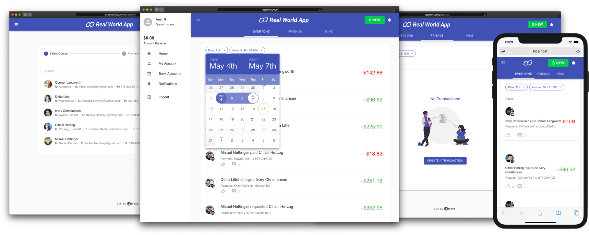

<p align="center">
  <strong><a href="https://demo.hwk-resume.web.chickenkiller.com">데모 링크</a></strong>
</p>

<p align="center">
  <!-- We use two SVGs here so that this displays correctly
    on Github. This might not look right in other Markdown previewers. -->
  
  
</p>

<p align="center">
A payment application used as a portfolio project for <strong>end-to-end testing with <a href="https://playwright.dev">Playwright</a></strong>. Forked from the <a href="https://github.com/cypress-io/cypress-realworld-app">Cypress Real World App</a>.
</p>

<p align="center">
  
</p>

> 💬 **Note from maintainers**
>
> This application is purely for demonstration and educational purposes. Its setup and configuration resemble typical real-world applications, but it's not a full-fledged production system. Use this app to learn, experiment, tinker, and practice application testing with Cypress.
>
> Happy Testing!

---

## License Compliance

This repository is a personal fork of the [Cypress Real World App](https://github.com/cypress-io/cypress-realworld-app) by Cypress.io, distributed under the [MIT License](LICENSE).

- The original MIT License text and the copyright notice (Copyright (c) 2020 Cypress.io) are retained in [LICENSE](LICENSE).
- This fork is used **solely for non-commercial purposes** (personal learning and portfolio), and it is not affiliated with, endorsed by, or sponsored by Cypress.io. Cypress logos and trademarks are not used.
- My modifications are shared under the same MIT License.
- The software is provided "as is", without warranty of any kind; see [LICENSE](LICENSE).

**한국어 안내**

이 저장소는 Cypress.io의 [Cypress Real World App](https://github.com/cypress-io/cypress-realworld-app)을 개인적으로 포크한 것이며, [MIT 라이선스](LICENSE)를 따릅니다.

- 원본 MIT 라이선스 전문과 저작권 고지(Copyright (c) 2020 Cypress.io)를 [LICENSE](LICENSE)에 그대로 유지합니다.
- **오직 비상업적 목적**(개인 학습, 포트폴리오)으로만 사용하며, Cypress.io와 제휴·보증·후원 관계가 없습니다. Cypress 로고와 상표는 사용하지 않습니다.
- 제가 수정한 부분도 동일하게 MIT 라이선스로 공유합니다.
- 소프트웨어는 어떠한 보증도 없이 "있는 그대로" 제공됩니다. 자세한 내용은 [LICENSE](LICENSE)를 참고하세요.

---

# Web - App 자동화 테스트 예제 프로젝트

Cypress.io 팀 웹 데모 대상, Web과 App 자동화 테스트 구현 시연

| 구분                 | 링크                                                                     |
| -------------------- | ------------------------------------------------------------------------ |
| Web Repo (이 저장소) | https://github.com/wonderwall1995/cypress-realworld-for-portfolio        |
| App Repo             | https://github.com/wonderwall1995/cypress-realworld-for-portfolio-mobile |
| Web 배포 링크        | https://demo.hwk-resume.web.chickenkiller.com/                           |
| 이력서               | https://resume-hwk.ltwayne0.workers.dev/main                             |

<!-- 실행 방법, 기술 스택, 폴더 구조 같은 안내는 이 아래에 직접 채운다. -->

## 문제 프레임

실질적인 목표는 **자동화 테스트 코드의 구조**를 자신이 어떻게 다루는지 보이고 싶었습니다.
원래 존재하던 **Cypress.io 측에서 MIT 라이선스로 배포 중인 웹 데모를 개량.**
기능 개선을 Web Repo에서 마치고, Web에서의 기능을 따와 Flutter Native 앱으로도 구현했습니다.

## 설계

테스트 코드는 배포된 Web에서 실제 어떻게 실행되는지 **Playwright 실행을 모방**하여 진행합니다.
배포된 웹에서 개별 테스트 코드에 대한 조회와 테스트 진행에 대한 시연을 보는 것이 가능합니다.
시연은 data-testid 색인된 UI 대상으로 자동화 테스트가 진행되며, 동시에 API 테스트 코드를 통한 검증을 혼합합니다. UI/UX 자동화 코드가 변경에 취약한 점이나, API 테스트 코드가 렌더링되는 UI 대상으로는 검증이 미비할 수 있는 점을 **UI/UX 및 API 자동화 테스트 방식이 혼합된 테스트 코드를 하나로 작성**함으로써 보완하는 시도입니다.

App에서의 자동화 테스트는 Appium + Wdio(드라이버) 방식으로 구현되었으며,
Web 측의 데모 제품과 기능이 대부분 일치합니다.
테스트에 사용되는 값(Fixture)을 사용하는 면에서는 Prisma + PostgreSQL 측에 **자동화 테스트를 위한 DB 내, Fixture를 생성할 때 이를 기록**하고 테스트 코드에 특정되는 Row 값을 Fixture로서 삽입하는 방식으로 Web과 App에서의 자동화 테스트 시나리오가 깨지지 않게끔 시도했습니다.

Web에서의 Playwright 사용으로 크게 세 개의 테스트 코드를 나눠둔 상태입니다.
하나는 .ts 확장자를 가지는 '공용 테스트', 같은 .ts 확장자를 가지는 'API 테스트' 그리고 실제 Playwright CLI 명령어로 실행시키는 .spec.ts 테스트 코드로 나뉩니다.
개별 .spec.ts 코드는 **Playwright가 가지는 병렬적 실행이 가능하다는 장점을 활용**, .spec.ts **테스트 코드 간 병목이나 종속성을 가급적 배제한 상태**로 테스트를 실행합니다.

## 아쉬운 점

앞서 거론된 **공용 테스트** 코드, **API 테스트** 코드의 경우에도
실패와 성공에 대해서 따로 세심하게 기록을 하면 좋겠다는 생각도 있습니다.
조금 더 해볼 수 있다면 Grafana와 Test Record가 든 스키마 혹은 테이블 측면을 연결.
**개별 .spec 테스트 코드 이외의 코드들도 실제 성공 및 실패 여부를 그려내는 것**도 해보면 좋지 않을까,
그런 아쉬움이 있습니다. - **현재 과다 스펙이라 여겨진 구상**입니다.

## 회고 (KPT)

### Keep

- 재직 중에 경험치 못한 API 테스트 코드의 구현 방식을 본 프로젝트에서 학습할 수 있었습니다.
- UI/UX 및 API 자동화 테스트 가지는 단점을 상호 보완하는 시도가 좋았다고 판단됩니다.

### Problem

1. Mocking이나 데이터 흐름 테스트에 대한 요소도 익혀 나가야 할 것 같습니다.
2. Jmeter와 같은 테스트 도구로 비기능적인 부분을 테스트하면 좋겠다는 생각이 있습니다.

### Try

- App에는 Web과 동일 기능을 가지는 것 이외, 독자적인 기능을 추후에 넣는 것도 필요할 것 같습니다.
- 복잡한 테스트를 적용하기엔 아직 웹 앱 데모의 개발 내용이 많지 않아 추후에 시도해보고자 합니다.

---

## Features

🛠 Built with [React][reactjs], [XState][xstate], [Express][express], [PostgreSQL][postgresql] with [Prisma][prisma], [Material-UI][material-ui] and [TypeScript][typescript]
🐘 PostgreSQL (Docker) with Prisma migrations
🚀 Full-stack [Express][express]/[React][reactjs] application with real-world features and tests
👮‍♂️ Local Authentication
🔥 Database Seeding with End-to-end Tests
🎭 End-to-end tests with [Playwright](https://playwright.dev)

## Getting Started

The app is a full-stack Express/React application backed by [PostgreSQL][postgresql], accessed with [Prisma][prisma].

> 🚩 **Note**
>
> The database starts empty and there is no sample data. Create your own users with the sign-up page.

### Prerequisites

This project requires [Node.js](https://nodejs.org/en/) to be installed on your machine. Refer to the [.node-version](./.node-version) file for the exact version.

[pnpm](https://pnpm.io/) is used as the package manager. If you have Node.js' [Corepack](https://nodejs.org/dist/latest/docs/api/corepack.html) enabled, the version pinned in `package.json` (`packageManager`) is used automatically:

```shell
corepack enable
```

Otherwise, install pnpm globally:

```shell
npm install pnpm -g
```

### Installation

To clone the repo to your local system and install dependencies, execute the following commands:

```shell
git clone https://github.com/wonderwall1995/cypress-realworld-for-portfolio
cd cypress-realworld-for-portfolio
cp .env.example .env   # local settings; .env itself is git-ignored
pnpm install
pnpm playwright:install
```

### Start the database

PostgreSQL runs in Docker. Start it (and the web app) with:

```shell
pnpm docker:up
```

Then create the tables once:

```shell
pnpm prisma:migrate
```

### Run the app

```shell
pnpm dev
```

> 🚩 **Note**
>
> The app will run on port `7201` (frontend) and `7202` (API backend) by default. Please make sure there are no other applications or services running on both ports.
> If you want to change the default ports, you can do so by modifying `PORT` and `VITE_BACKEND_PORT` variables in `.env` file.
> If you change the frontend port, also update `baseURL` and `webServer.url` in [playwright.config.ts](./playwright.config.ts).

### Run the Playwright tests

```shell
pnpm test          # run all tests headless (starts the app automatically if it is not running)
pnpm test:ui       # Playwright UI mode
pnpm test:headed   # run in headed browsers
pnpm test:report   # open the last HTML report
```

## Tests

| Type | Location                                                                                                                 |
| ---- | ------------------------------------------------------------------------------------------------------------------------ |
| e2e  | [`tests/e2e`](./tests/e2e) (Playwright)                                                                                  |
| unit | [`apps/api/src/__tests__`](./apps/api/src/__tests__), [`packages/shared/src/__tests__`](./packages/shared/src/__tests__) |

Unit tests run with `pnpm test:unit`.

## Database

- The database is PostgreSQL. It runs in Docker (`docker-compose.yml`) and its data is kept in a Docker volume, so it stays when the app restarts.

- The tables are defined in [apps/api/prisma/schema.prisma](./apps/api/prisma/schema.prisma) and created by the migrations in [apps/api/prisma/migrations](./apps/api/prisma/migrations) (`pnpm prisma:migrate`).

- Updates from the React frontend go to the [Express][express] server, which reads and writes with Prisma. The data access code is in the `apps/api/src/*-db.ts` files.

- There is no sample data. Unit tests use a separate database (`<name>_test`) that is emptied before each test, so they never touch your development data.

## Additional NPM Scripts

| Script         | Description                                                                |
| -------------- | -------------------------------------------------------------------------- |
| dev            | Starts backend in watch mode and frontend                                  |
| dev:auth0      | Starts backend in watch mode and frontend; [Uses Auth0](#auth0)            |
| dev:okta       | Starts backend in watch mode and frontend; [Uses Okta](#okta)              |
| dev:cognito    | Starts backend in watch mode and frontend; [Uses Cognito](#amazon-cognito) |
| dev:google     | Starts backend in watch mode and frontend; [Uses Google](#google)          |
| start          | Starts backend and frontend                                                |
| types          | Validates types                                                            |
| docker:up      | Starts PostgreSQL and the app in Docker                                    |
| docker:down    | Stops the Docker containers (the database volume is kept)                  |
| prisma:migrate | Creates or updates the database tables (Prisma migrations)                 |
| test:unit      | Runs the unit tests (API and shared package)                               |
| lint           | Runs ESLint and the Prettier check                                         |

For a complete list of scripts see [package.json](./package.json)

## 3rd Party Authentication Providers

Support for 3rd party authentication is available in the application to demonstrate the concepts on logging in with a 3rd party provider.

The app contains different entry points for each provider. There is a separate **index** file for each provider, and to use one, you must replace the current **index.tsx** file with the desired one. The following providers are supported:

- [Auth0](#auth0) (index.auth0.tsx)
- [Okta](#okta) (index.okta.tsx)
- [Amazon Cognito](#amazon-cognito) (index.cognito.tsx)
- [Google](#google) (index.google.tsx)

### Auth0

Prerequisites include an Auth0 account and a Tenant configured for use with a SPA. Environment variables from Auth0 are to be placed in the [.env](./.env). For more details see [Auth0 Application Setup](http://on.cypress.io/auth0#Auth0-Application-Setup) and [Setting Auth0 app credentials in Cypress](http://on.cypress.io/auth0#Setting-Auth0-app-credentials-in-Cypress).

To start the application with Auth0, replace the current **apps/web/src/index.tsx** file with the **apps/web/src/index.auth0.tsx** file and start the application with `pnpm dev:auth0`.

### Okta

A [guide has been written with detail around adapting the RWA](http://on.cypress.io/okta) to use [Okta][okta].

Prerequisites include an [Okta][okta] account and [application configured for use with a SPA][oktacreateapp]. Environment variables from [Okta][okta] are to be placed in the [.env](./.env).

To start the application with Okta, replace the current **apps/web/src/index.tsx** file with the **apps/web/src/index.okta.tsx** file and start the application with `pnpm dev:okta`.

### Amazon Cognito

A [guide has been written with detail around adapting the RWA](http://on.cypress.io/amazon-cognito) to use [Amazon Cognito][cognito] as the authentication solution.

Prerequisites include an [Amazon Cognito][cognito] account. Environment variables from [Amazon Cognito][cognito] are provided by the [AWS Amplify CLI][awsamplify].

- A user pool is required (identity pool is not used here)
  - The user pool must have a hosted UI domain configured, which must:
    - allow callback and sign-out URLs of `http://localhost:7201/`,
    - allow implicit grant Oauth grant type,
    - allow these OpenID Connect scopes:
      - aws.cognito.signin.user.admin
      - email
      - openid
  - The user pool must have an app client configured, with:
    - enabled auth flow `ALLOW_USER_PASSWORD_AUTH`, only for programmatic login flavor of test.
    - The `cy.origin()` flavor of test only requires auth flow `ALLOW_USER_SRP_AUTH`, and does not require `ALLOW_USER_PASSWORD_AUTH`.
  - The user pool must have a user corresponding to the `AWS_COGNITO` env vars mentioned below, and the user's Confirmation Status must be `Confirmed`. If it is `Force Reset Password`, then use a browser to log in once at `http://localhost:7201` while `pnpm dev:cognito` is running to reset their password.

The test knobs are in a few places:

- The `.env` file has `VITE_AUTH_TOKEN_NAME` and vars beginning `AWS_COGNITO`. Be careful not to commit any secrets.
- Both `apps/web/scripts/mock-aws-exports.js` and `apps/web/scripts/mock-aws-exports-es5.js` must have the same data; only their export statements differ. These files can be edited manually or exported from the amplify CLI.

To start the application with Cognito, replace the current **apps/web/src/index.tsx** file with the **apps/web/src/index.cognito.tsx** file and start the application with `pnpm dev:cognito`.

### Google

A [guide has been written with detail around adapting the RWA](https://docs.cypress.io/guides/testing-strategies/google-authentication.html) to use [Google][google] as the authentication solution.

Prerequisites include an [Google][google] account. Environment variables from [Google][google] are to be placed in the [.env](./.env).

To start the application with Google, replace the current **apps/web/src/index.tsx** file with the **apps/web/src/index.google.tsx** file and start the application with `pnpm dev:google`.

## License

[](./LICENSE)

This project is licensed under the terms of the [MIT license](/LICENSE).

[reactjs]: https://reactjs.org
[xstate]: https://xstate.js.org
[express]: https://expressjs.com
[postgresql]: https://www.postgresql.org/
[prisma]: https://www.prisma.io/
[typescript]: https://typescriptlang.org
[material-ui]: https://material-ui.com
[okta]: https://okta.com
[auth0]: https://auth0.com
[oktacreateapp]: https://developer.okta.com/docs/guides/sign-into-spa/react/create-okta-application/
[cognito]: https://aws.amazon.com/cognito
[awsamplify]: https://amplify.aws
[google]: https://google.com

## Contributors ✨

Thanks goes to these wonderful people ([emoji key](https://allcontributors.org/docs/en/emoji-key)):

<!-- ALL-CONTRIBUTORS-LIST:START - Do not remove or modify this section -->
<!-- prettier-ignore-start -->
<!-- markdownlint-disable -->
<table>
  <tr>
    <td align="center"><a href="http://www.kevinold.com"><br /><sub><b>Kevin Old</b></sub></a></td>
    <td align="center"><a href="https://twitter.com/amirrustam"><br /><sub><b>Amir Rustamzadeh</b></sub></a></td>
    <td align="center"><a href="https://twitter.com/be_mann"><br /><sub><b>Brian Mann</b></sub></a></td>
    <td align="center"><a href="https://glebbahmutov.com/"><br /><sub><b>Gleb Bahmutov</b></sub></a></td>
    <td align="center"><a href="http://www.bencodezen.io"><br /><sub><b>Ben Hong</b></sub></a></td>
    <td align="center"><a href="https://github.com/davidkpiano"><br /><sub><b>David Khourshid</b></sub></a></td>
  </tr>
</table>

<!-- markdownlint-enable -->
<!-- prettier-ignore-end -->

<!-- ALL-CONTRIBUTORS-LIST:END -->

This project follows the [all-contributors](https://github.com/all-contributors/all-contributors) specification. Contributions of any kind welcome!!
