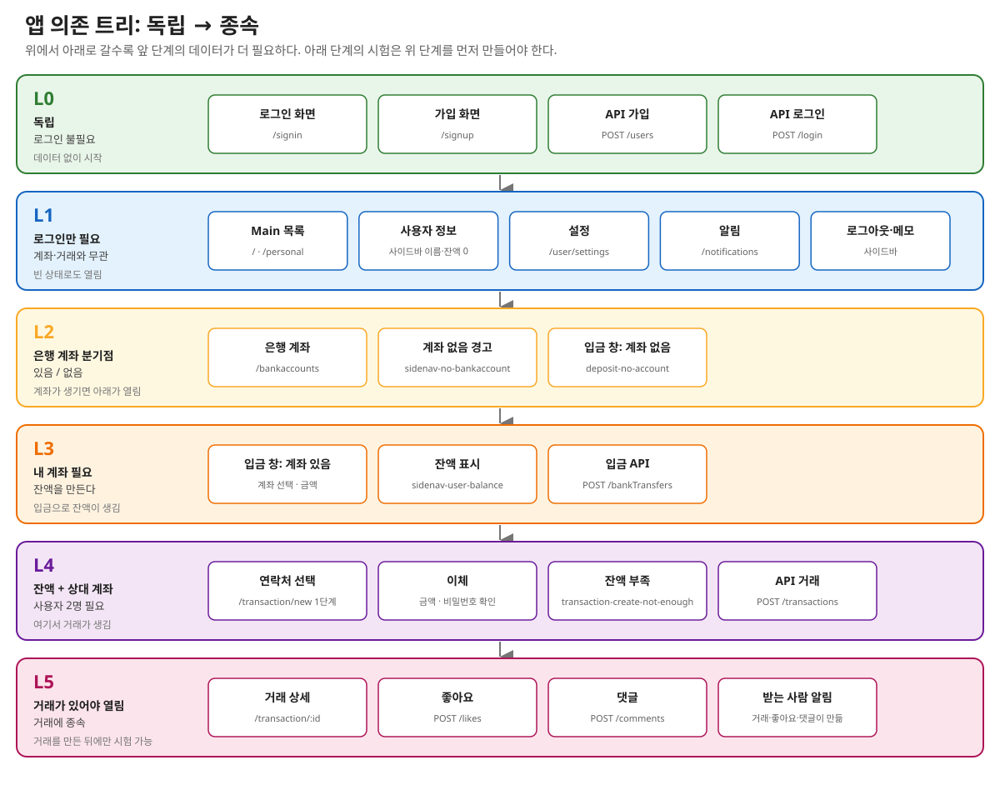

# 앱 의존 트리 (독립 → 종속)

테스트를 나누는 기준을 정하기 위한 고찰 문서다.
기준: "로그인 이후, 어떤 데이터가 있어야 그 화면·기능을 시험할 수 있는가".
아래의 사실은 코드(라우트, 컴포넌트, API)를 읽고 적었다. 테스트 묶음은 제안이며 아직 정하지 않았다.

(PNG 판: [dependency-tree.png](./dependency-tree.png))

## 1. 단계 설명

| 단계 | 필요한 것 | 화면·기능 | 근거 |
| --- | --- | --- | --- |
| L0 | 없음 | `/signin`, `/signup`, API 가입(`POST /users`), API 로그인(`POST /login`) | 로그인 검사 밖에 있음 |
| L1 | 로그인 | Main 목록(`/`, `/personal`), 사이드바 사용자 정보, 설정, 알림, 로그아웃, 메모 | `PrivateRoute`만 통과하면 열림. 목록은 비어도 열림 |
| L2 | 로그인 (은행 계좌는 이 단계에서 만든다) | 은행 계좌(`/bankaccounts`), 계좌 없음 경고(`sidenav-no-bankaccount`), 입금 창의 "계좌 없음" 안내(`deposit-no-account`) | 계좌가 0개일 때의 화면 |
| L3 | 내 은행 계좌 1개 이상 | 입금 창(계좌 선택, 금액), 잔액 표시, 입금 API(`POST /bankTransfers`) | 입금 창이 `GET /bankAccounts`로 계좌를 읽음 |
| L4 | 내 계좌 + 잔액 + 받는 사람(다른 사용자)의 계좌 | `/transaction/new` 3단계(연락처 선택, 이체, 완료), 잔액 부족 경고, 비밀번호 확인, `POST /transactions` | 이체 단계가 내 계좌와 받는 사람의 계좌를 모두 읽음. 보내는 쪽은 비밀번호를 다시 입력해야 함 |
| L5 | 거래 1건 이상 | 거래 상세(`/transaction/:id`), 좋아요, 댓글, 받는 사람 알림 | 거래 id가 있어야 화면이 열림. 알림은 거래·좋아요·댓글이 만듦 |

## 2. 분기점

- **은행 계좌 있음 / 없음**이 첫 분기다. 같은 입금 창이 계좌 수에 따라 다른 화면을 보인다.
- **사용자 수**가 둘째 분기다. L4부터는 사용자 2명(보내는 쪽, 받는 쪽)이 모두 계좌를 가져야 한다.
- **잔액**은 L3의 입금으로만 생긴다. 잔액이 없으면 L4 이체가 막힌다(`transaction-create-not-enough`).

## 3. 로그인 방식의 제약

- 앱이 로그인 상태를 브라우저 저장소(`localStorage`의 `authState`)에 둔다. 화면을 열 때 서버 세션을 확인하지 않는다.
- 그래서 API로 로그인해도 화면은 로그인되지 않는다. 화면을 로그인시키려면 화면에서 로그인해야 한다.
- 결과: 모든 L1 이후 테스트의 출발은 "API로 계정을 만들고, 화면에서 로그인한다"이다(`common/go-to-main.ts`).

## 4. 데이터를 만드는 방법 (도구)

| 만들 것 | 화면으로 | API로 |
| --- | --- | --- |
| 계정 | `/signup` | `POST /users` (`api/create-account.ts`) |
| 은행 계좌 | `/bankaccounts` 양식 | `POST /bankAccounts` |
| 잔액 | 입금 창 | `POST /bankTransfers` (`type: deposit`) |
| 거래 | `/transaction/new` | `POST /transactions` (비밀번호 필요) |

API 도구는 아래 단계의 시험을 위한 "준비 단계"로 쓴다. 시험하려는 기능 자체는 화면으로 한다.
단, 런너(`playwright.ts`)에는 아직 `GET` 요청, 선택 상자(select), 글자 확인이 없다. 쓰려면 먼저 추가해야 한다.

## 5. 아직 정하지 않은 것

- 묶음 경계: L1을 한 파일로 할지, 설정·알림으로 나눌지.
- 이체(L4)에 필요한 두 번째 사용자를 시연에서 어떻게 보일지(API 도구로 만들면 화면에는 안 나옴).
- 거래 요청(request) 기능은 이미 지웠으므로 이 트리에 넣지 않았다.
